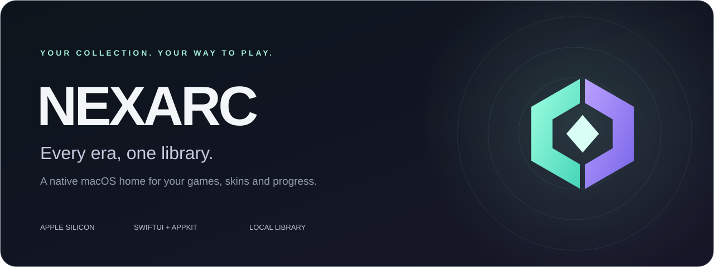
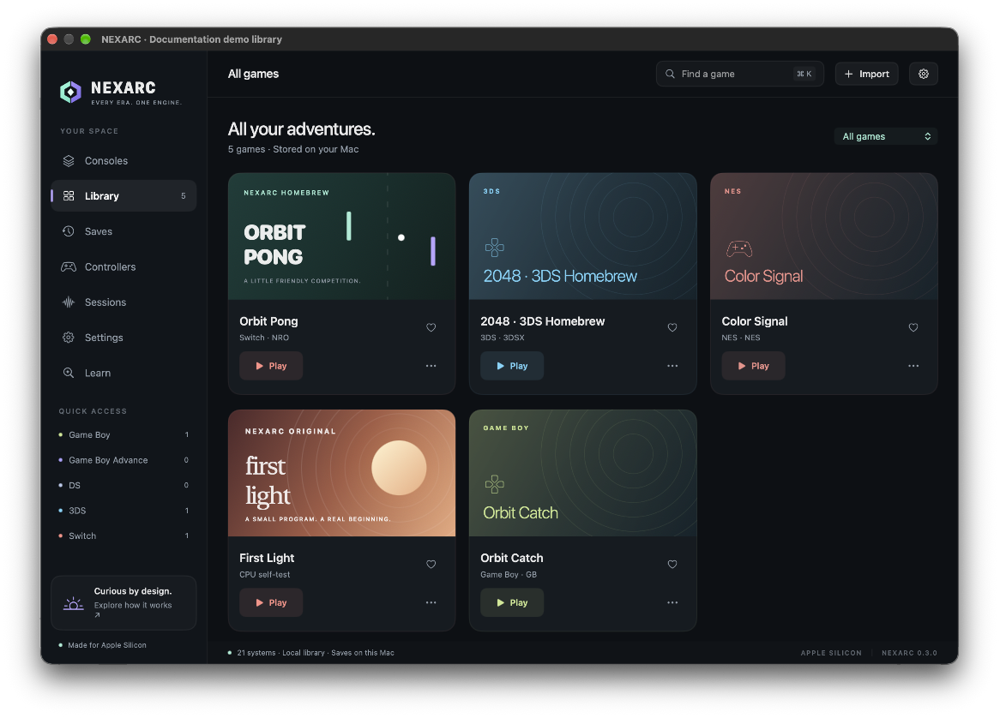
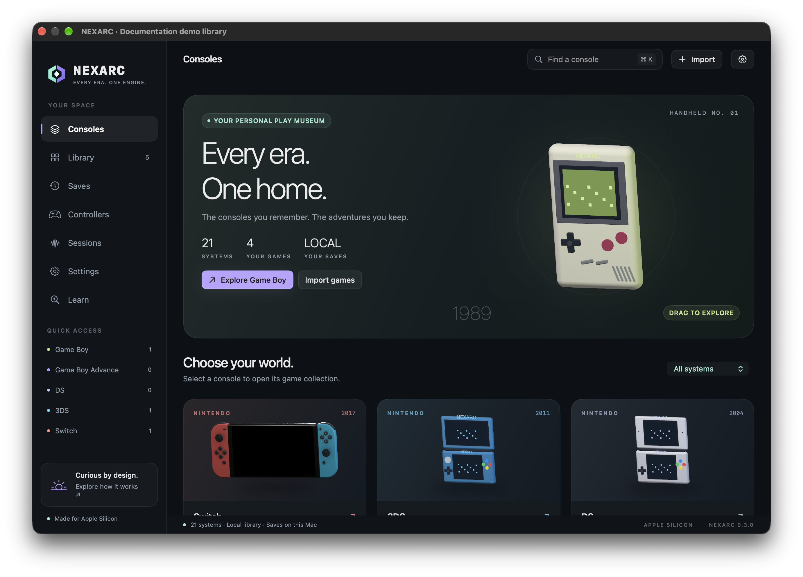
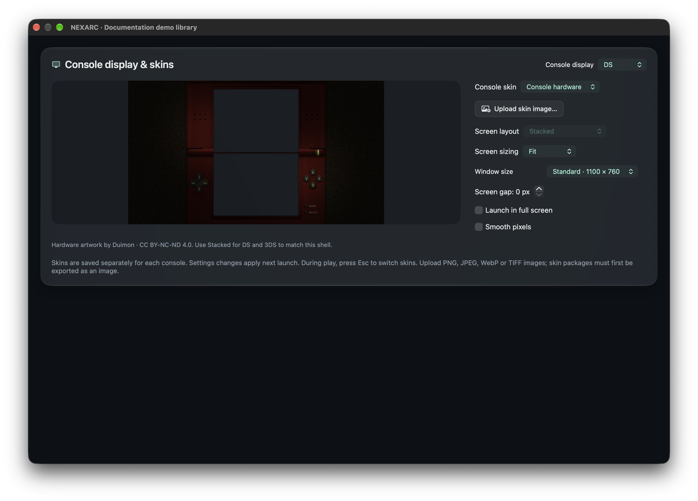
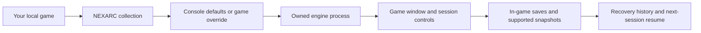

<div align="center">



<h1>NEXARC</h1>

<p><strong>Your collection. Your console. Your way to play.</strong><br />
A native macOS multi-console emulation frontend with a local game library,<br />
handheld skins, visual save slots and controller support.</p>


<p>
<a href="#download--install">Download for Mac</a> ·
<a href="#all-versions">All versions</a> ·
<a href="#app-gallery">App gallery</a> ·
<a href="#your-library-your-progress">Features</a> ·
<a href="docs/USER-GUIDE.md">Player guide</a> ·
<a href="#build--study">Build from source</a>
</p>

<sub>Independent study and portfolio project. Emulation is powered by credited upstream engines.</sub>

</div>

---

> Import your games, choose a console and pick up where you left off.
>
> NEXARC provides the macOS interface, library, skins, progress tools and engine integration. Title compatibility varies; 21 collections does not mean every game works. This is an experimental build with known runtime limitations. No commercial ROMs, console keys or firmware are included.

## Download & install

<!-- nexarc:version -->
**Newest version: `0.3.0`**

**The first public DMG has not been published yet.** The local installer is ready to build; public downloads will appear here once a release is published.

### All versions

| Version | Date | Status | macOS installer | Release notes |
|---|---|---|---|---|
| `0.3.0` | 2026-11-13 | **Newest** · Local build | Not published | [Changes](CHANGELOG.md#030---2026-11-13) |

Every published version keeps its own DMG, source archive, checksums, and release notes. Older downloads remain available under [GitHub Releases](https://github.com/jzc9307/NEXARC/releases). Local or prepared versions are listed without a live download link until publication succeeds.
<!-- /nexarc:version -->

**You do not need VS Code, Xcode or .NET to run a packaged release.** Download its DMG, then:

1. Open `NEXARC-X.Y.Z-macOS-arm64.dmg`.
2. Drag **NEXARC.app** into **Applications** using the shortcut in the disk image.
3. Eject the disk image and open NEXARC from Applications.
4. Select a console and import your own compatible game files.

| Requirement | Details |
|---|---|
| Mac | Apple Silicon; macOS 14 or later |
| Download | Each published version has its own DMG; ZIP and source archives are also provided |
| Updates | Quit the running game and NEXARC before replacing the app; the library remains in Application Support |
| Signing | Locally signed, currently **not notarized** by Apple |

macOS may block an unnotarized app on first launch. Only if you trust the download, follow **System Settings → Privacy & Security** to allow it. Do not disable Gatekeeper globally. Older builds may contain known bugs; use the latest compatible release and export saves before changing core versions.

## At a glance

| Your collection | Your screen | Your progress |
|---|---|---|
| 21 console collections | Hardware artwork for supported handhelds | Six visual save slots on supported retro cores |
| Imports and cached cover art | Custom image uploads and screen placement | Automatic resume on normal exit where supported |
| Search, favorites and recently played | Independent DS/3DS top and touch layouts | Rolling recovery copies before replacement/load |
| Keyboard and controller integration | Per-console and per-game preferences | Local saves, checksums and backup export |

## Contents

- [Download & install](#download--install)
- [All versions](#all-versions)
- [App gallery](#app-gallery)
- [Your library, your progress](#your-library-your-progress)
- [Handheld skins & screen layouts](#handheld-skins--screen-layouts)
- [Controls & fast-forward](#controls--fast-forward)
- [Consoles & compatibility](#consoles--compatibility)
- [Local data & privacy](#local-data--privacy)
- [Build & study](#build--study)
- [Documentation & credits](#documentation--credits)

## App gallery

Screenshots below are from the running NEXARC app using a separate demo library and the bundled homebrew programs. The banner is original NEXARC artwork, not a game screenshot. No user's commercial-game library or private saves are shown.

[](docs/screenshots/library.png)

<table>
<tr>
<td width="50%" valign="top">
<a href="docs/screenshots/consoles.png"></a>
<p><strong>Explore your consoles</strong><br />Open a collection and see the games you imported for that system.</p>
</td>
<td width="50%" valign="top">
<a href="docs/screenshots/display-settings.png"></a>
<p><strong>Make it your setup</strong><br />Choose handheld artwork, screen layouts and a window-size preset.</p>
</td>
</tr>
</table>

## Your library, your progress

Import a local file or drop it into the library. Recognized extensions identify the console; ambiguous disc formats ask you to choose. Retro imports become managed local copies; large Switch files stay at their imported path. Games are not downloaded by NEXARC.

Cover art checks a same-name local image first, then an optional exact-title match from Libretro's thumbnail collections. Unmatched games keep designed fallback artwork, and you can choose a cover yourself. During play, the active card shows the session timer; other games wait until that session ends.

| Action | Where to find it | Behavior |
|---|---|---|
| Save a snapshot | Game details → Save slots; session menu; F5 | Writes the selected slot and stores a screenshot when the core provides one |
| Load progress | Resume, a visual slot, or F8 | Protects current play before a live slot load; checks core compatibility and file integrity |
| Recover an earlier snapshot | Game details → Recovery backups | Keeps up to ten recovery copies; restore while the game is stopped |
| Resolve display trouble | Now Playing → Recovery | Refresh the display, restart from an in-game save, or export diagnostics |
| Leave a session | Esc → Save & return / Return to library | Uses the supported save workflow and graceful core exit |
| Export a backup | Game details → Your progress | Exports save data, slots and recovery copies separately from ROMs |

In-game saves and emulator snapshots are different. **Switch uses in-game saves and has no snapshot slots.** Snapshot formats depend on the core build; keep in-game saves for long-term progress. Restarting can lose unsaved play. A display refresh cannot resolve every possible game/core fault.



## Handheld skins & screen layouts

Go to **Settings → Console display & skins**, choose the console at the top, then select an available skin. Community hardware artwork is included for **DS, 3DS, Game Boy, Game Boy Color, GBA, PSP and Game Gear**. Home consoles default to a screen-only view. Classic/Neon are optional NEXARC stylizations, separate from hardware artwork.

Upload PNG, JPEG, WebP or TIFF images and place the screen inside the artwork by dragging its rectangle and resize handle. DS/3DS can place the **Top** and **Touch** screens independently; lower-screen mouse input follows its configured area. Fine adjustment exposes exact percentages. Emulator-specific ZIP/skin packages must first be exported as an image.

**Window presets:** Small · Standard · Large · Fit to display · Custom. You only type dimensions when choosing Custom. A game's display override can keep a different skin, layout or window preset from the console default. Settings apply on the next launch; the retro session menu can cycle available skins during play.

Community artwork retains its original credits and license. It is not official manufacturer artwork. See the [player guide](docs/USER-GUIDE.md) for limits and supported upload sizes.

## Controls & fast-forward

| Input | Action |
|---|---|
| Arrow keys | Default direction controls |
| X / Z / S / A | Default A / B / X / Y actions; mappings can be changed |
| Esc | Open the custom paused menu; Esc or an outside click resumes |
| F5 / F8 | Save / load the session menu's selected slot on supported cores |
| Hold Tab | Selected fast-forward target: **2×, 3×, 4× or 5×** |
| Hold Shift + Tab | Target 5×; release for normal speed |
| Gamepad D-pad / left stick | Navigate library items; A/Cross plays and X/Square opens details |

The Controllers page shows a keyboard when no gamepad is detected. Gamepad navigation, remapping and family previews are implemented; **physical-controller validation remains pending**. Per-game overrides cover keyboard, logical gamepad layout and speed; Switch can snapshot its controller profiles. Fast-forward targets depend on the core, title and hardware; they are not guaranteed performance multipliers.

Optional Discord Rich Presence shows the running game and console through Discord's local IPC connection after you supply your own Discord application ID. See [setup](docs/USER-GUIDE.md).

## Consoles & compatibility

| Collections | Current evidence / limits |
|---|---|
| Game Boy, NES | Bundled homebrew rendered and passed save/load/resume checks |
| DS | Focused local-title tests covered resume, save/load, layouts and display recovery; title compatibility still varies |
| 3DS | Bundled 2048 homebrew passed rendering and save/load checks; software graphics default |
| Switch | Source-built Ryujinx-derived engine retained; homebrew checked; sustained Vulkan presentation has shown intermittent crashes |
| GBC, GBA, SNES, N64, GameCube, Wii | Engine routes are bundled; broad title-level validation is incomplete |
| Mega Drive, Master System, Game Gear, Dreamcast, Saturn | Engine routes are bundled; broad title-level validation is incomplete |
| PlayStation, PSP, PC Engine, Atari 2600 | Engine routes are bundled; broad title-level validation is incomplete |
| PlayStation 2 | Experimental Play! route; no broad compatibility claim |

Retro systems use RetroArch/libretro cores; Switch uses the retained Ryujinx-derived engine. NEXARC integrates these engines and does not claim their CPU/GPU implementations as original work. Required BIOS/firmware/keys are not supplied. Read the [verification record](docs/VERIFICATION.md) for exactly what was tested.

Included programs: **Orbit Catch** (Game Boy), **Color Signal** (NES), **2048** by 0rientd (3DS), **Orbit Pong** (Switch), and **First Light** (Switch CPU diagnostic with no graphics).

## Local data & privacy

The library, settings and saves live in `~/Library/Application Support/NEXARC`. Normal app updates do not relocate that folder. Earlier Helio-managed data is migrated when applicable. Runtime QA uses isolated copies rather than resetting a player's library.

Game imports stay local. Cover matching can request public system/title filenames from Libretro thumbnails; it does not upload the ROM or a ROM hash. Discord activity is optional. NEXARC includes no cloud-save service or game download catalog.

## Build & study

To **play a release**, use the DMG above. To study or modify the source:

```sh
bash scripts/fetch-retro.sh
bash scripts/build-core.sh
bash scripts/test.sh
python3 -m unittest discover -s Tests -p 'test_release.py'
bash scripts/build.sh
```

Native builds require Apple's command-line tools and an Apple Silicon Mac. Building the Switch engine also needs the .NET 10 SDK. The scripts reuse the outer workspace cache locally; a fresh clone uses ignored `work/` and `dist/` folders. Upstream binary snapshots are checksum-pinned; fresh-clone dependency availability still needs verification. No claim of a fully offline reproducible build is made.

```text
Sources/                  SwiftUI/AppKit frontend and engine bridge
EngineSource/             Credited Switch engine source
Resources/                Homebrew, artwork, metadata and notices
Tests/                    App logic, file integrity and release regressions
scripts/                  Build, DMG creation and versioned GitHub publishing
VERSION / BUILD_NUMBER    Current app version and macOS build number
release-history.json      Publication state used by the README download table
CHANGELOG.md              Changes for every recorded version
docs/                     Player guide, verification and release instructions
```

## Documentation & credits

| Document | Purpose |
|---|---|
| [Player guide](docs/USER-GUIDE.md) | Imports, layouts, controls, progress and per-console limitations |
| [Study guide](docs/START-HERE.md) | Code ownership, architecture and learning path |
| [Verification](docs/VERIFICATION.md) | Test evidence and known runtime issues |
| [GitHub release guide](docs/GITHUB.md) | Version bumps, DMGs, history and publication |
| [Repository appearance](docs/GITHUB-APPEARANCE.md) | GitHub description, topics, avatar and social preview |
| [Changelog](CHANGELOG.md) | What changed in each version |
| [Third-party credits](THIRD-PARTY.md) | Engine, homebrew, model and artwork attribution |

NEXARC project code uses the [MIT license](LICENSE). Upstream engines, dependencies and artwork retain their separate licenses, including GPL and noncommercial terms. Public binary distribution requires matching source/notices and asset-license review; credit alone is not a completed compliance review. Product names and trademarks belong to their owners; this independent project is not endorsed by console manufacturers.
